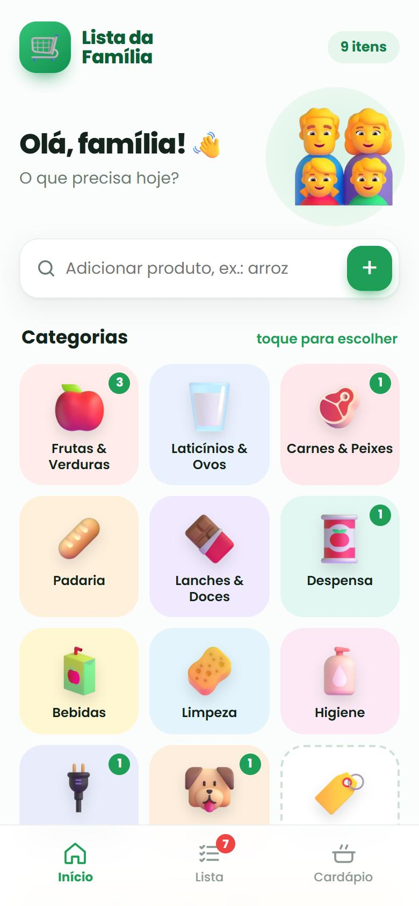
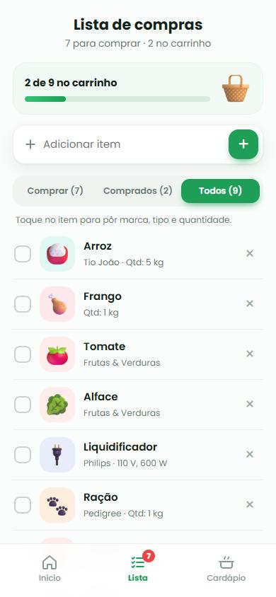
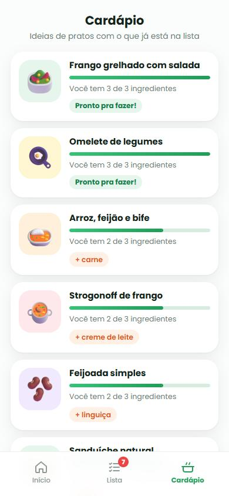

# 🛒 Lista da Família

**A lista de compras da casa, com cara de aplicativo e sem instalar nada.**

&nbsp;&nbsp;
&nbsp;&nbsp;

## O que ele faz

- **Categorias coloridas.** Frutas, padaria, limpeza, casa & eletro, pet e outras abrem uma gaveta para adicionar os itens mais comuns com um toque.
- **Qualquer produto, do seu jeito.** Cada item pode ter marca, tipo ou especificação (ex.: 110 V, integral, sem lactose) e quantidade. O mesmo produto pode entrar com marcas diferentes.
- **Ícone e categoria automáticos.** O app reconhece o produto pelo nome: arroz vai para Despensa 🍚, liquidificador para Casa & Eletro 🔌.
- **Comprar / Comprados / Todos.** Basta marcar o que já foi para o carrinho.
- **Sugestões da família.** Mostra o que vocês mais compram e ainda não está na lista.
- **Cardápio.** Sugere pratos com o que está na lista e mostra o que falta. Um toque adiciona o que falta.

## Como usar

Abra **https://rico2978bg-hub.github.io/lista-compras/** no celular ou no computador. No celular, dá para usar "Adicionar à tela inicial" e abrir como um app.

Para rodar localmente, basta abrir o `index.html` no navegador. Não precisa instalar nada.

## Detalhes

- Tudo fica em um único arquivo (`index.html`), com HTML, CSS e JavaScript puros.
- Os dados ficam salvos só no seu navegador (`localStorage`). Nada é enviado para servidor nenhum.
- Ícones: [Fluent Emoji 3D](https://github.com/microsoft/fluentui-emoji), da Microsoft (licença MIT). Sem internet, o app usa os emojis comuns do sistema.
